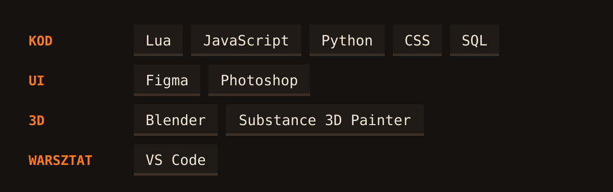

Maciek, ale wszyscy mówią Garnuszek. Od ponad 5 lat siedzę w FiveM: piszę skrypty, rysuję do nich interfejsy, a modele i tekstury też robię sam, bo tak jest szybciej.

### Na gazie

Teraz cała robota idzie w **FlyRP**. Skrypty, UI, modele, wszystko po kolei.

### Gdzie już gotowałem

`WaitRP` &nbsp; `WavesRP` &nbsp; `AstroRP` &nbsp; `OneRP` &nbsp; `OrionRP`

### Z czego gotuję

### Zamówienia

Masz robotę albo chcesz pogadać o skrypcie, to pisz.

Discord: `garnuchhh` 
Mail: [fanszanelki@gmail.com](mailto:fanszanelki@gmail.com)
